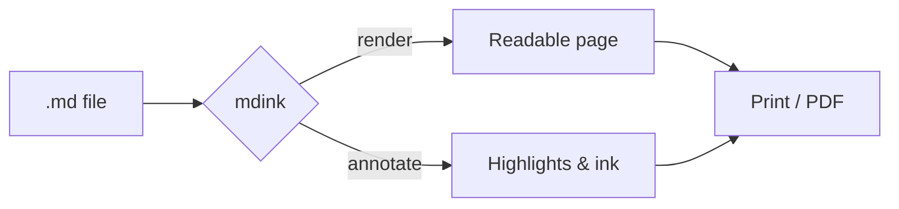

# Welcome to mdink

A tiny, portable Markdown viewer — no install, no setup. Open a file with **Ctrl+O**, drop one on the window, or use *Open with → mdink* in Explorer.

> [!TIP]
> Try the tools on the right: select some text and pick a color to **highlight** it, grab the **pen** (P) to write in the margin, or drop a **text note** (T) anywhere. Annotations are saved per file and printed with the page.

## What it renders

| Feature | Example |
|---|---|
| GitHub-flavored Markdown | tables, ~~strikethrough~~, task lists, footnotes[^1] |
| Code with syntax colors | `js`, `python`, `bash`, `csharp`, … |
| Diagrams | ` ```mermaid ` blocks — flowcharts, sequence, gantt, class, ER… |
| Math | inline $e^{i\pi} + 1 = 0$ and display blocks |
| Alerts | `> [!NOTE]`, `> [!WARNING]` … |
| Right-to-left text | Persian, Arabic and Hebrew paragraphs flip automatically |

### A diagram



### Some math

The quadratic formula:

$$
x = \frac{-b \pm \sqrt{b^2 - 4ac}}{2a}
$$

### Some code

```python
def greet(name: str) -> str:
    """Return a friendly greeting."""
    return f"Hello, {name}!"

print(greet("mdink"))
```

### متن فارسی

این یک پاراگراف فارسی است. جهت متن به‌صورت خودکار راست‌به‌چپ می‌شود و با فونت **وزیرمتن** نمایش داده می‌شود. می‌توانید فونت را از منوی **Aa** عوض کنید.

- مورد اول فهرست
- مورد دوم با `code` و English words

### Checklist

- [x] Open a file
- [x] Zoom with **Ctrl + mouse wheel**
- [ ] Highlight something
- [ ] Write a note in the margin
- [ ] Print it or save as PDF (**Ctrl+Shift+S**)

> [!NOTE]
> Press **?** for all keyboard shortcuts, **D** to toggle dark mode, **Ctrl+\\** for the outline.

[^1]: Footnotes show up at the bottom of the page, like this one.
